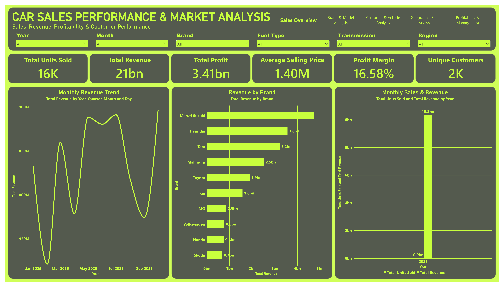
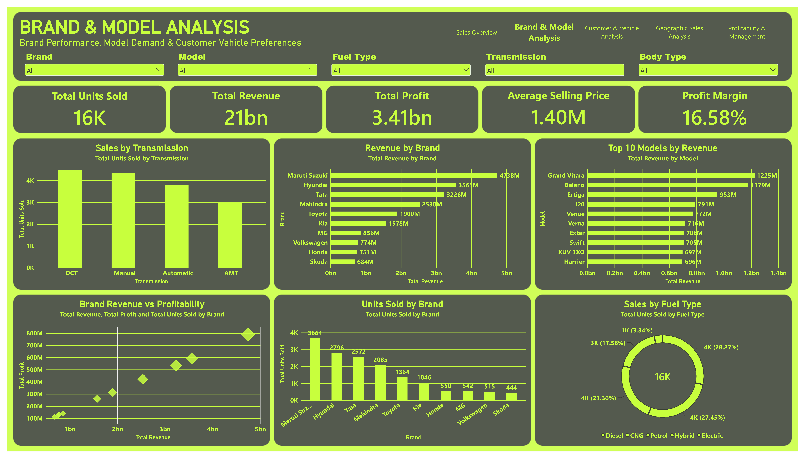
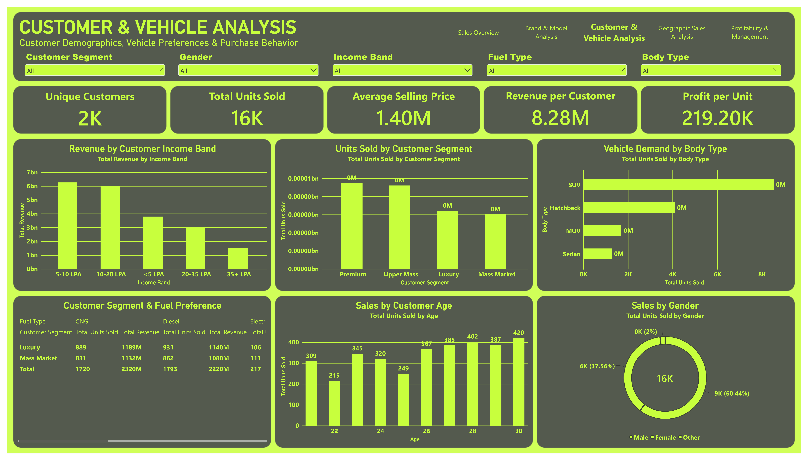
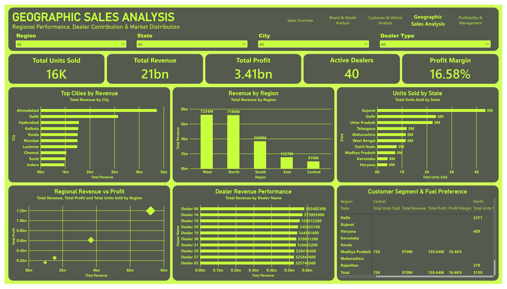
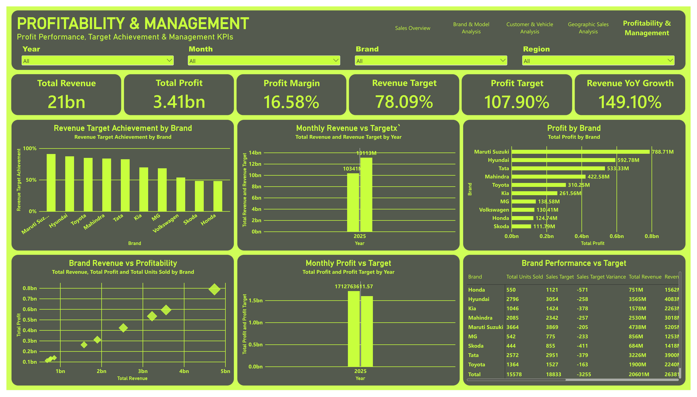

# Car Sales Performance & Market Analysis | Power BI

A Power BI dashboard portfolio project analyzing vehicle sales, revenue, profitability, customer and vehicle preferences, geographic performance, and sales target achievement using a synthetic practice dataset.

## Project Overview

This five-page report explores car sales performance from business, customer, product, and geographic perspectives. It helps stakeholders review overall sales KPIs, compare vehicle brands and models, understand customer segments, examine regional and dealer contributions, and monitor revenue and profit against targets.

> **Dataset note:** This is a synthetic portfolio dataset for practice and demonstration. The figures below are values displayed in the supplied dashboard PDF, not verified results from a real dealership or automotive company.

## Key Metrics Reported

| KPI | Dashboard result |
|---|---:|
| Total Units Sold | 16K |
| Total Revenue | 21bn |
| Total Profit | 3.41bn |
| Average Selling Price | 1.40M |
| Profit Margin | 16.58% |
| Unique Customers | 2K |
| Revenue per Customer | 8.28M |
| Profit per Unit | 219.20K |
| Active Dealers | 40 |
| Revenue Target Achievement | 78.09% |
| Profit Target Achievement | 107.90% |
| Revenue YoY Growth | 149.10% |

Values retain the dashboard's displayed rounding and unit formatting. Validate measure definitions, currency/unit scaling, and target calculations in the Power BI model before interpreting them as business conclusions.

## Dashboard Pages

### 1. Sales Overview

Summarizes total units sold, revenue, profit, average selling price, profit margin, and unique customers. Includes monthly revenue trends, revenue by brand, and monthly sales and revenue.



### 2. Brand & Model Analysis

Compares brand revenue and unit sales, transmission preferences, top models by revenue, brand profitability, and fuel-type mix.



### 3. Customer & Vehicle Analysis

Explores revenue by customer income band, units by customer segment, vehicle body type, fuel preference, customer age and gender, revenue per customer, and profit per unit.



### 4. Geographic Sales Analysis

Reviews top cities by revenue, revenue by region, units sold by state, dealer revenue performance, and regional revenue versus profit.



### 5. Profitability & Management

Tracks revenue and profit, profit margin, revenue and profit targets, revenue target achievement by brand, monthly actuals versus targets, profit by brand, and sales-target variance.



## Selected Insights

- **Maruti Suzuki** has the highest displayed brand revenue at approximately **4.7bn**, with **3,664 units sold**.
- **Hyundai** records approximately **3.6bn** in revenue and **2,796 units sold**.
- **Grand Vitara** leads the displayed top-10 model revenue chart at approximately **1,225M**, followed by **Baleno** at approximately **1,179M**.
- The geographic page reports revenue of approximately **7,234M** for the West region and **7,190M** for the North region.
- The management page displays **78.09% revenue target achievement**, **107.90% profit target achievement**, and **149.10% revenue YoY growth**.

These are descriptive observations from the report. They do not establish why a brand or region performs as it does.

## Tools & Skills Demonstrated

- **Microsoft Power BI:** multi-page dashboards, KPI cards, slicers, comparative charts, and management scorecards
- **DAX and KPI analysis:** sales, revenue, profit, margin, average selling price, target achievement, and year-over-year growth as represented in the report
- **Microsoft Excel:** source workbook and structured dataset
- **Business analytics:** brand and model comparison, customer segmentation, geographic analysis, dealer contribution, and target monitoring
- **Data storytelling:** communicating performance patterns through interactive visualizations

## Excel Workbook Structure

The supplied Excel workbook contains the following sheets:

| Worksheet | Purpose |
|---|---|
| `FactSales` | Sales records and numeric sales measures |
| `DimCar` | Car / model attributes |
| `DimCustomer` | Customer attributes |
| `DimDealer` | Dealer attributes |
| `DimLocation` | Geographic attributes |
| `DimDate` | Date attributes |
| `Targets` | Sales targets |
| `Project_Info` | Project and dataset information |

The workbook contains **15,000 sales records** in `FactSales`, **2,500 customers**, **40 dealers**, and **15 locations**, according to the supplied workbook's project information.

## Data Quality & Interpretation Notes

- Some customer/body-type visuals in the supplied PDF appear to display zero or near-zero values even though other visuals report substantial sales. Validate the relevant visuals, measures, and filter context in Power BI before using those charts to support conclusions.
- The dashboard rounds several KPIs (for example, `16K` units and `21bn` revenue). Preserve the displayed format when quoting the report and check the underlying measures for exact values.
- Target achievement and year-over-year growth are documented as displayed; their formulas and comparison periods were not independently audited for this README.

## Repository Structure

```text
Car-Sales-Performance-Power-BI/
├── README.md
├── Car Sales Analysis(1).pbix
├── Car Sales Analysis(1).xlsx
└── screenshots/
    ├── sales-overview.png
    ├── brand-model-analysis.png
    ├── customer-vehicle-analysis.png
    ├── geographic-sales-analysis.png
    └── profitability-management.png
```

The screenshot files in this bundle were rendered from the supplied `Car Sales Analysis.pdf`. The PBIX and Excel source files are not duplicated in this bundle; keep the original files in your repository and preserve their filenames, or update the tree if you rename them.

## Business Questions Explored

- Which brands and models contribute the most revenue?
- How do units sold and revenue vary by transmission and fuel type?
- How do customer segments and income bands relate to reported sales?
- Which regions, cities, states, and dealers contribute most to revenue?
- How do brand profitability and sales results compare with targets?

## Author

**Altamash Nizamuddin**  
Data Analyst | Excel • Power BI • Python • MySQL  
Mumbai, India

- GitHub: [@altamash-analyst](https://github.com/altamash-analyst)
- Email: [altamash9876@gmail.com](mailto:altamash9876@gmail.com)

Open to Data Analyst, Business Analyst, BI Analyst, and Power BI Developer opportunities.

## GitHub Repository Metadata

**Repository name:** `Car-Sales-Performance-Power-BI`

**Suggested repository description:**

> Power BI car sales dashboard analyzing vehicle revenue, profit, brands, models, customer preferences, regional sales, dealer performance, and target achievement using a synthetic Excel dataset.

**Recommended GitHub topics:**

`power-bi` `car-sales-analysis` `automotive-analytics` `sales-dashboard` `profitability-analysis` `customer-segmentation` `business-intelligence` `data-analytics` `dax` `microsoft-excel` `sales-performance` `Altamash-Analyst`

---

*Portfolio project demonstrating automotive sales analytics, dashboard development, and business intelligence with Power BI and Excel.*
